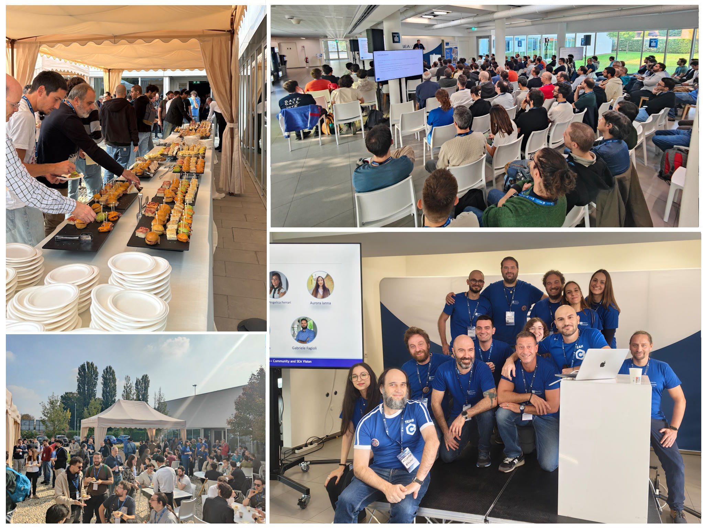
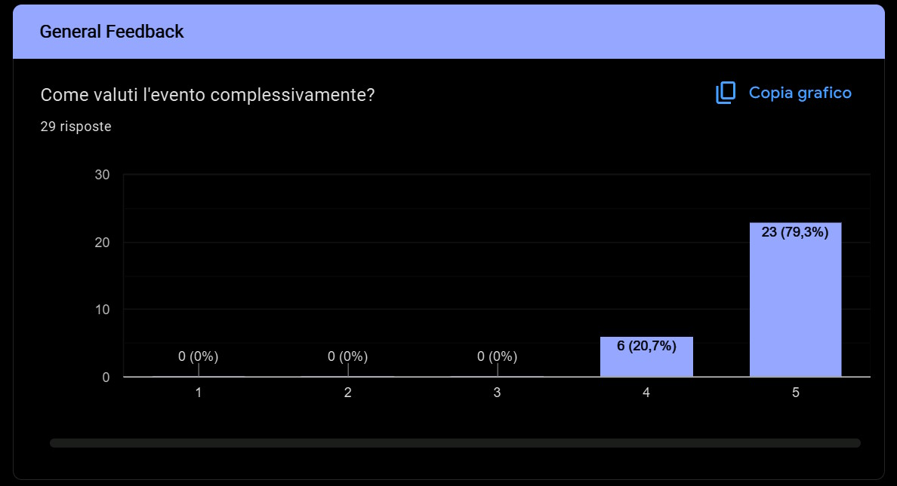
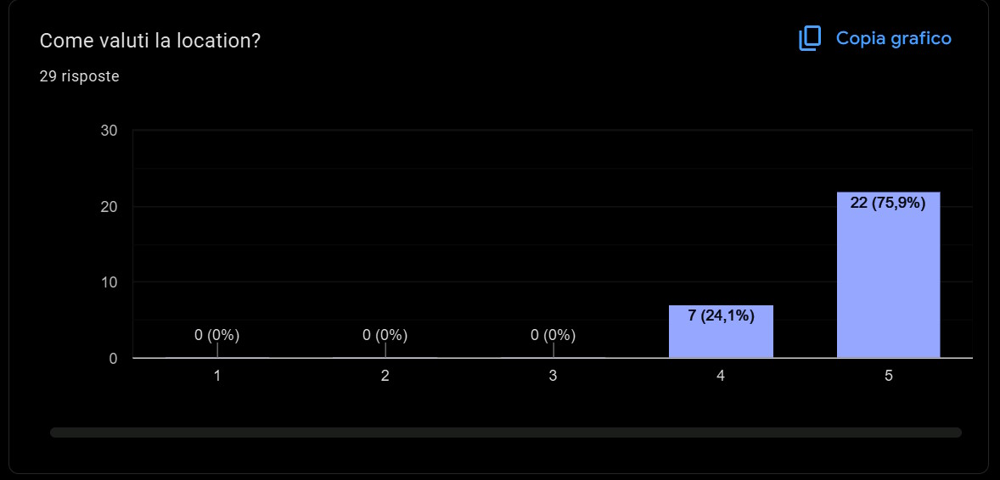
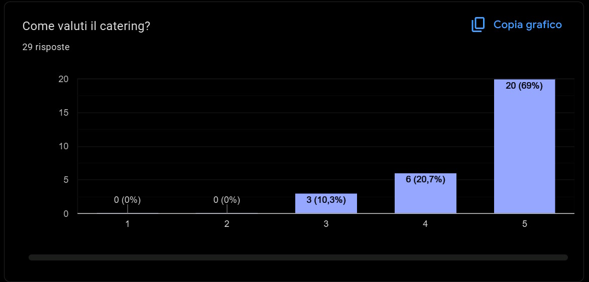

# C++ Day 2026: Wrap-up post

 

 

On October 17th, we were super happy to host [C++ Day 2026](https://italiancpp.github.io/cppday26/) in Pavia at **SEA Vision**'s venue! This one-day community event brought together **150 attendees** to enjoy tech talks, workshops, networking, and activities around C++ development.

Here is the classical wrap-up post.

Some information:

* the event was totally **free** to attend
* total number of attendees: **150**

The event had 4 **sponsors** which covered the event costs:

- [SEA Vision](https://seavision-group.it) (main sponsor, co-organizer and host)
- [thinkcell](https://www.thinkcell.com/)
- [Deep Vision Consulting](https://deepvisionconsulting.com/)
- [SIGEO](https://www.sigeosrl.com/)

**Thanks to all the speakers and attendees!**

Some pictures of the event are [here on our Facebook page](https://www.facebook.com/media/set/?vanity=italiancpp&set=a.1731333375666945).

#### Some stats

**How long have you been programming with C++?**

* I don't use C++: 19%  
* <1 year: 5%  
* **1-5 years: 24%**
* 6-10 years: 19%
* 11-15 years: 14%
* 16-20 years: 6%
* $\ge$20 years: 13%

**If you program in C++, which standard do you use the most?**

* C++98/C++03: 4% (last year was 3%)
* C++11: 10% (last year was 11%)
* C++14: 4% (last year was 9%)
* **C++17: 37%** (last year was 31%)
* C++20: 29% (last year was 31%)
* C++23: 12% (last year was 9%)
* C++26: 4% (last year was not asked)

**Are you looking for job opportunities?**

* **Yes: 51%** (last year was 38%)
* No: 49% (last year was 62%)

**Your company** (optional, aggregated without duplicates):

<ul>
  <li>Argo vision</li>
  <li>AxC</li>
  <li>Capgemini</li>
  <li>Cineca</li>
  <li>COMELZ S.p.A.</li>
  <li>Deep Vision Consulting</li>
  <li>Egalware s.r.l.</li>
  <li>Elen Spa</li>
  <li>Ferrari S.p.A.</li>
  <li>Globant</li>
  <li>IBM</li>
  <li>ICAM SpA</li>
  <li>Idetica</li>
  <li>ION</li>
  <li>IT G. Marconi - Verona</li>
  <li>KDAB</li>
  <li>Luxoft</li>
  <li>Marchesini Group</li>
  <li>Mediobanca</li>
  <li>Mito / Tierra</li>
  <li>Nacon Studio Milan</li>
  <li>Nexi Payment S.pA</li>
  <li>Politecnico di Milano</li>
  <li>Qualcomm</li>
  <li>QubicaAMF</li>
  <li>Randstad Digital</li>
  <li>Red Hat</li>
  <li>RETELIT</li>
  <li>Rossini Energy</li>
  <li>SEA Vision</li>
  <li>Sinthesi S.r.l.</li>
  <li>Sitti</li>
  <li>Sopra Steria</li>
  <li>TeiaCare SRL</li>
  <li>Texa S.p.a.</li>
  <li>TEXA Spa</li>
  <li>TMC Italia s.p.a</li>
  <li>Topcon Agriculture</li>
  <li>TXT E-Tech</li>
  <li>Unibo</li>
  <li>Unipv</li>
  <li>Zuru Tech</li>
</ul>

#### Structure and contents of the event

**C++ Day 2026** was a one-day event focused on C++ development, featuring a single-track program of technical talks and a parallel track of 2x120-min worksghops, interleaved with 2 coffee breaks and lunch.

The schedule included multiple speakers:

- **Alberto Barbati**: C++26 Execution Control: un'introduzione
- **Sergei Kushnirenko**: Interesting Allocators in Games
- **Roberta Cisotti**: Dal codice legacy ad un registro di algoritmi moderni: rifattorizzazione di centinaia di operazioni di elaborazione delle immagini
- **Paolo Severini**: Zero-Overhead Dispatch: Sfruttare `__musttail` e Custom ABI in C++
- **Giorgio Bignotti**: GIS a costo zero: parsing di formati binari in C++23
- **Stefano Cristiano**: Old-School C++ for the Agentic Age: Lessons from Sane C++ Libraries

All talks are available for watching on [YouTube](https://www.youtube.com/playlist?list=PLb7Ly2DOEgD4).

We also had two hands-on workshops:

- **Daniele Pallastrelli**: La forma del cambiamento: progettare sistemi C++ che evolvono
- **Davide Bianchi**: Waiting for reflection: everything you wish you never knew about macros

Main topics:

- C++26 Sender/Receiver
- Allocators in Game Development
- Modernization of a Computer Vision application
- Zero-Overhead Dispatch
- C++23 binary parsing
- C++ for agentic AI

#### Issues

No major issues were reported; the venue provided a professional environment with comfortable spaces for talks, networking, and catering.

The only issue we had (which was also reported last year) was that the support screens intended to help attendees in the back see the slides were positioned too low. We tried to mitigate this, but due to a misunderstanding with the audio/video service providers, they remained difficult to view properly.

#### Feedback

About 20% of attendees gave feedback (less than last year) and we are glad the results were very good. In addition, all the talks were appreciated, getting high rates.

 

 

 

See you next time!